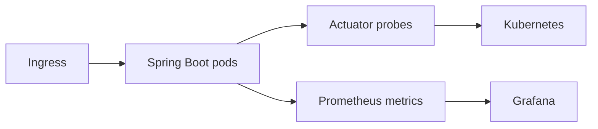

# CloudOps Spring Starter

An opinionated Spring Boot service baseline for teams that want operational readiness built into the first commit.

## Included

- Java 17 and Spring Boot 3
- Health, readiness, liveness, metrics, and Prometheus endpoints
- A stable HTTP contract with correlation-ID propagation
- Non-root container execution and bounded JVM memory
- Kubernetes probes, resources, and security context
- Integration test and GitHub Actions pipeline

## Operational contract



## Verify

```bash
mvn verify
docker build -t cloudops-spring-starter:local .
kubectl apply -f k8s/deployment.yml
```

## Design principles

1. Prefer observable failure over silent degradation.
2. Make health and resource expectations executable.
3. Run with least privilege.
4. Keep the application contract small enough to copy safely.
5. Extend through reviewed modules rather than hidden convention.

## Roadmap

OpenTelemetry tracing, structured JSON logs, Resilience4j defaults, Helm packaging, Terraform EKS module, SBOM generation, image signing, and staged deployment examples.

## Author

[Sameer Khan Pathan](https://github.com/sameerkhan63731) · [sameerwork.online](https://sameerwork.online)
